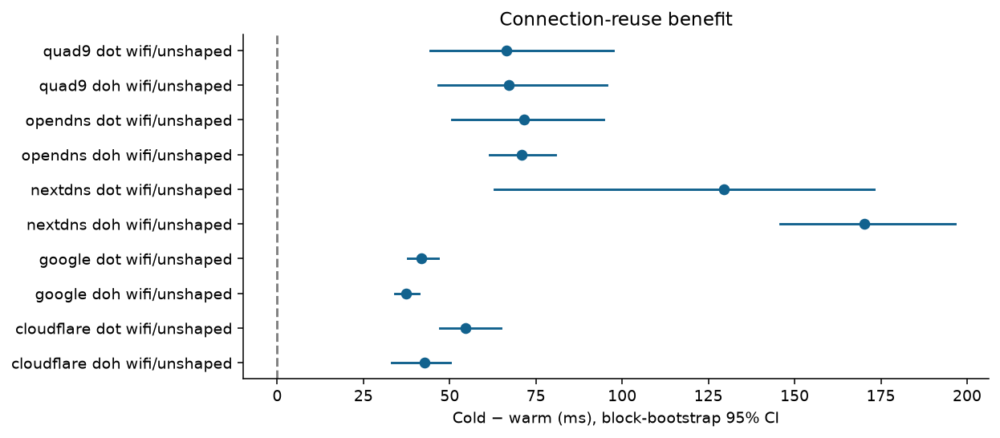
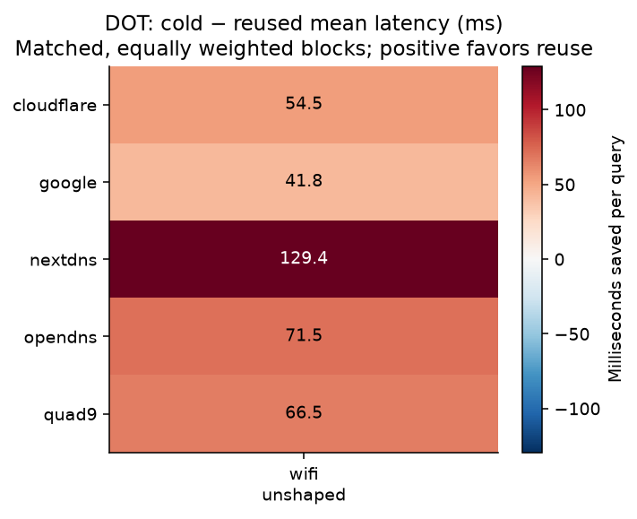
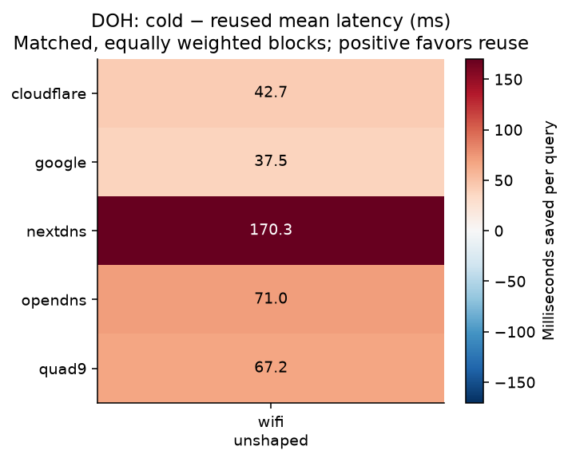
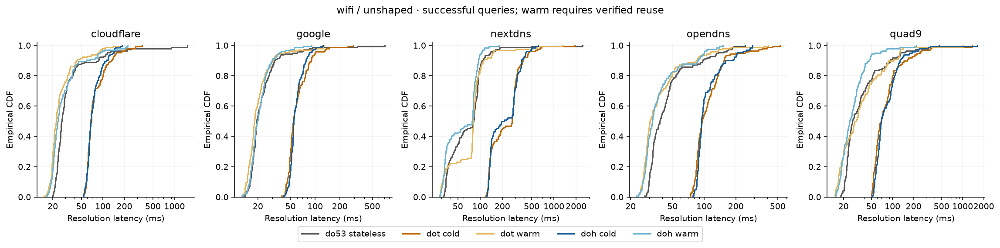
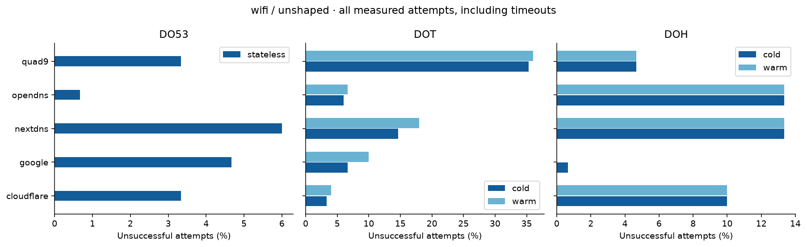
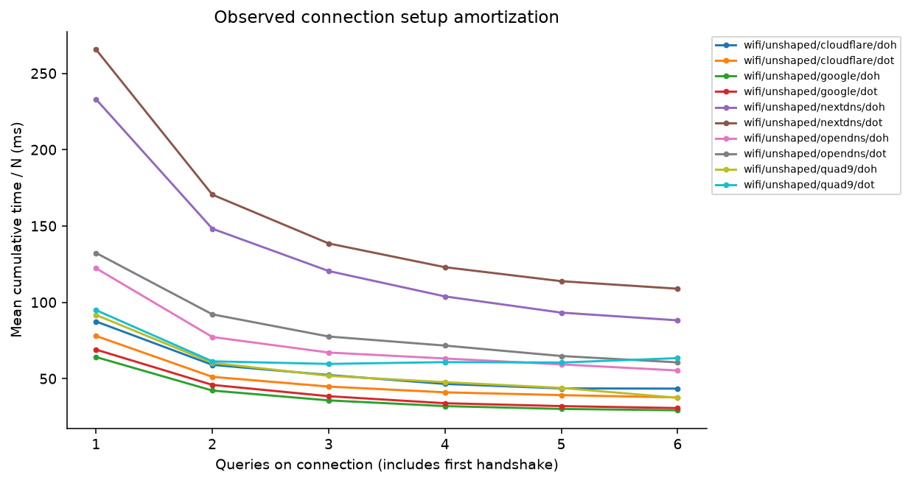

# DNS connection-reuse results

Measured attempts: **3,750** across **1** run(s).

Latency estimates include successful responses only. Warm estimates require observed connection reuse. Timeouts and other failures remain in the reliability denominators. CIs resample paired blocks, not individual queries.

| Network/profile | Resolver | Protocol | Paired queries | Blocks | Saved ms | Reduction | 95% CI (ms) |
|---|---|---|---:|---:|---:|---:|---|
| wifi/unshaped | cloudflare | doh | 135 | 27 | 42.71 | 55.2% | 33.19 to 50.06 |
| wifi/unshaped | cloudflare | dot | 143 | 29 | 54.53 | 64.3% | 47.09 to 64.77 |
| wifi/unshaped | google | doh | 149 | 30 | 37.48 | 62.7% | 34.08 to 41.18 |
| wifi/unshaped | google | dot | 135 | 27 | 41.79 | 64.5% | 37.88 to 46.56 |
| wifi/unshaped | nextdns | doh | 126 | 26 | 170.33 | 72.4% | 145.90 to 196.46 |
| wifi/unshaped | nextdns | dot | 121 | 25 | 129.39 | 54.8% | 62.86 to 173.08 |
| wifi/unshaped | opendns | doh | 130 | 26 | 70.96 | 62.9% | 61.64 to 80.63 |
| wifi/unshaped | opendns | dot | 140 | 28 | 71.55 | 60.7% | 50.73 to 94.65 |
| wifi/unshaped | quad9 | doh | 140 | 29 | 67.24 | 67.7% | 46.66 to 95.55 |
| wifi/unshaped | quad9 | dot | 63 | 24 | 66.51 | 64.8% | 44.39 to 97.36 |

## Reliability

| Resolver | Condition | Protocol/state | Attempts | Timeouts | Other failures | Warm reconnections |
|---|---|---|---:|---:|---:|---:|
| cloudflare | wifi/unshaped | do53/stateless | 150 | 5 | 0 | 0 |
| cloudflare | wifi/unshaped | doh/cold | 150 | 0 | 15 | 0 |
| cloudflare | wifi/unshaped | doh/warm | 150 | 0 | 15 | 15 |
| cloudflare | wifi/unshaped | dot/cold | 150 | 0 | 5 | 0 |
| cloudflare | wifi/unshaped | dot/warm | 150 | 0 | 6 | 6 |
| google | wifi/unshaped | do53/stateless | 150 | 7 | 0 | 0 |
| google | wifi/unshaped | doh/cold | 150 | 1 | 0 | 0 |
| google | wifi/unshaped | doh/warm | 150 | 0 | 0 | 0 |
| google | wifi/unshaped | dot/cold | 150 | 0 | 10 | 0 |
| google | wifi/unshaped | dot/warm | 150 | 0 | 15 | 15 |
| nextdns | wifi/unshaped | do53/stateless | 150 | 9 | 0 | 0 |
| nextdns | wifi/unshaped | doh/cold | 150 | 0 | 20 | 0 |
| nextdns | wifi/unshaped | doh/warm | 150 | 2 | 18 | 19 |
| nextdns | wifi/unshaped | dot/cold | 150 | 1 | 21 | 0 |
| nextdns | wifi/unshaped | dot/warm | 150 | 1 | 26 | 28 |
| opendns | wifi/unshaped | do53/stateless | 150 | 1 | 0 | 0 |
| opendns | wifi/unshaped | doh/cold | 150 | 0 | 20 | 0 |
| opendns | wifi/unshaped | doh/warm | 150 | 0 | 20 | 20 |
| opendns | wifi/unshaped | dot/cold | 150 | 1 | 8 | 0 |
| opendns | wifi/unshaped | dot/warm | 150 | 0 | 10 | 10 |
| quad9 | wifi/unshaped | do53/stateless | 150 | 5 | 0 | 0 |
| quad9 | wifi/unshaped | doh/cold | 150 | 0 | 7 | 0 |
| quad9 | wifi/unshaped | doh/warm | 150 | 0 | 7 | 6 |
| quad9 | wifi/unshaped | dot/cold | 150 | 0 | 53 | 0 |
| quad9 | wifi/unshaped | dot/warm | 150 | 1 | 53 | 51 |

## Interpretation limits

- A single network condition cannot establish the proposed network-quality relationship; missing conditions are not imputed.
- A run samples one vantage point and time window. Queries within a connection are dependent. Even blocks may share temporal network conditions.
- Fixed popular names favor resolver cache hits but do not guarantee them; DNS cache state is separate from connection state.
- At 100–150 trials, p99 is based on roughly the largest two or three observations; treat it as descriptive, not a precise tail estimate.
- Mann–Whitney tests compare block-mean effects, with Holm correction across all exported comparisons. They do not prove causation.
- Breakeven values use setup/N + warm latency, omit failures, and assume constant service time. A missing crossover can mean reuse never matches Do53 under this model.
- Profiles jointly vary latency, jitter, loss and rate. Exploratory per-predictor regressions cannot identify independent causal effects.
- No packet capture is required by this harness. Its setup values are application-observed TCP/TLS intervals, not pure propagation RTT.

See summary.csv for quantiles, variance and IQR; paired-blocks.csv for the inference units; comparisons.csv for corrected tests; breakeven.csv and regressions.csv for model outputs.

## Figures

