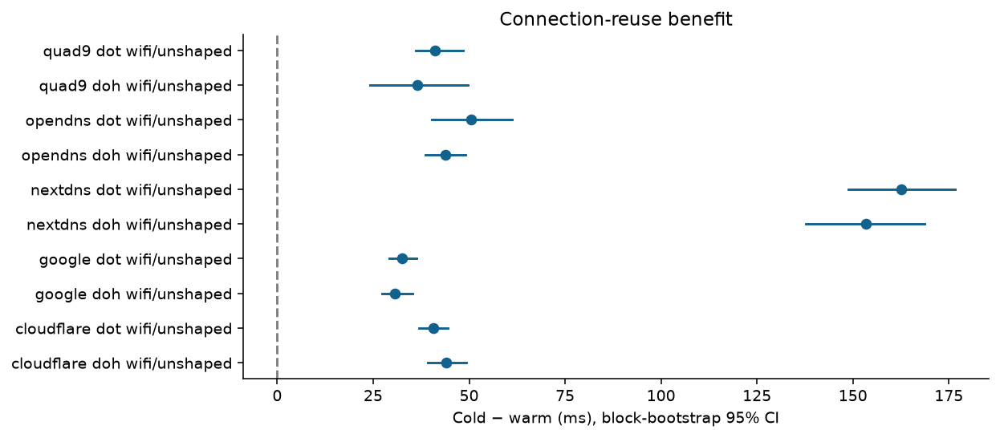
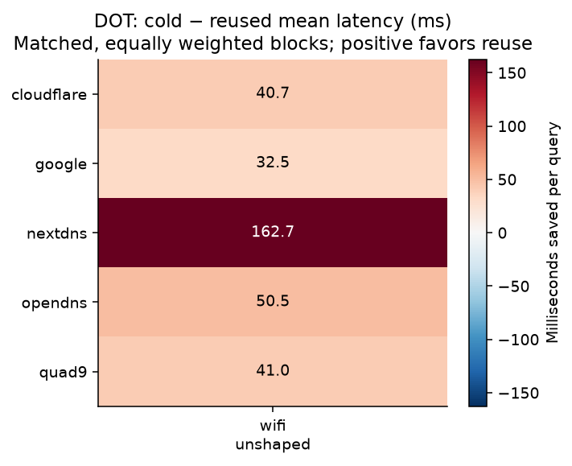
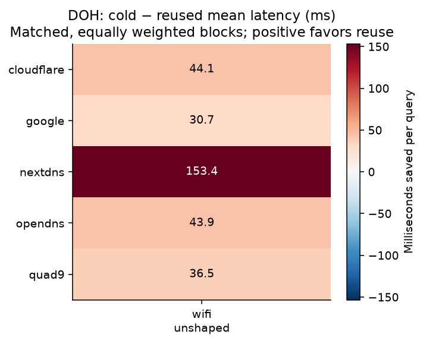
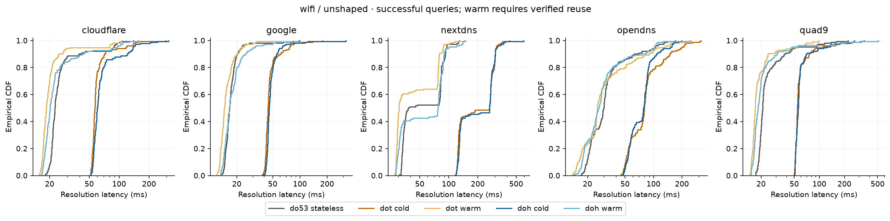
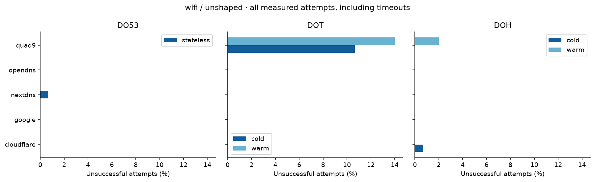
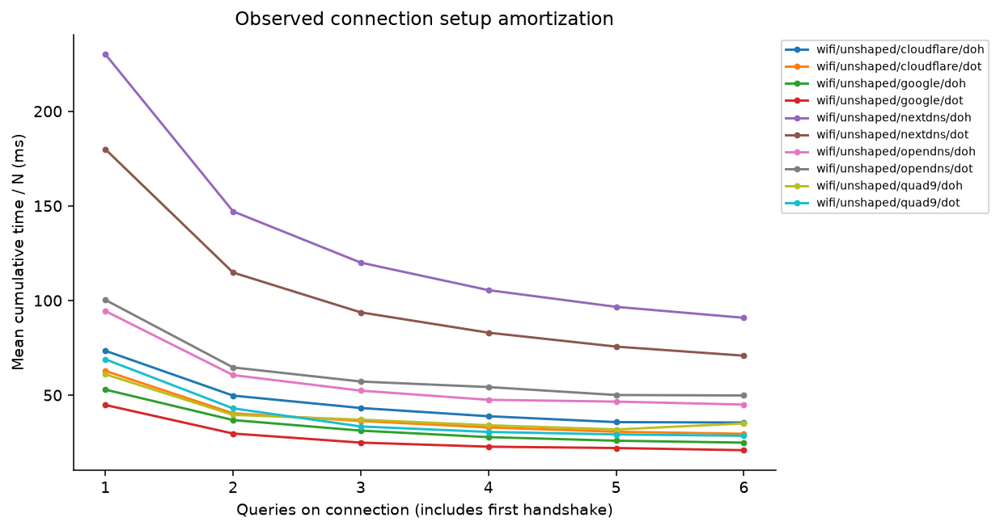

# DNS connection-reuse results

Measured attempts: **3,750** across **1** run(s).

Latency estimates include successful responses only. Warm estimates require observed connection reuse. Timeouts and other failures remain in the reliability denominators. CIs resample paired blocks, not individual queries.

## Collection quality

Run `be1b9afd68994770af5856369f26e19e`: 2026-09-30T17:29:51.690793+00:00 to 2026-09-30T17:38:29.417763+00:00.

Recorded context: Separate repeat after network-unreachable interruption in the prior run. Default route en0 is Wi-Fi; macOS idle sleep inhibited with caffeinate -i. Upstream access type, VPN state, and background traffic unverified.

- Observed failures are retained; latency estimates are success-conditioned

## Amortization

| Network/profile | Resolver | Protocol | Paired queries | Blocks | Saved ms | Reduction | 95% CI (ms) |
|---|---|---|---:|---:|---:|---:|---|
| wifi/unshaped | cloudflare | doh | 149 | 30 | 44.07 | 61.3% | 39.24 to 49.28 |
| wifi/unshaped | cloudflare | dot | 150 | 30 | 40.70 | 63.9% | 36.89 to 44.55 |
| wifi/unshaped | google | doh | 150 | 30 | 30.75 | 61.4% | 27.33 to 35.34 |
| wifi/unshaped | google | dot | 150 | 30 | 32.53 | 66.8% | 29.22 to 36.37 |
| wifi/unshaped | nextdns | doh | 150 | 30 | 153.42 | 70.9% | 137.67 to 168.74 |
| wifi/unshaped | nextdns | dot | 150 | 30 | 162.67 | 76.8% | 148.76 to 176.56 |
| wifi/unshaped | opendns | doh | 150 | 30 | 43.88 | 55.5% | 38.64 to 49.00 |
| wifi/unshaped | opendns | dot | 150 | 30 | 50.54 | 56.0% | 40.32 to 61.25 |
| wifi/unshaped | quad9 | doh | 145 | 30 | 36.54 | 56.2% | 24.12 to 49.71 |
| wifi/unshaped | quad9 | dot | 103 | 30 | 41.05 | 66.4% | 36.18 to 48.39 |

## Reliability

| Resolver | Condition | Protocol/state | Attempts | Timeouts | Other failures | Warm reconnections |
|---|---|---|---:|---:|---:|---:|
| cloudflare | wifi/unshaped | do53/stateless | 150 | 0 | 0 | 0 |
| cloudflare | wifi/unshaped | doh/cold | 150 | 1 | 0 | 0 |
| cloudflare | wifi/unshaped | doh/warm | 150 | 0 | 0 | 0 |
| cloudflare | wifi/unshaped | dot/cold | 150 | 0 | 0 | 0 |
| cloudflare | wifi/unshaped | dot/warm | 150 | 0 | 0 | 0 |
| google | wifi/unshaped | do53/stateless | 150 | 0 | 0 | 0 |
| google | wifi/unshaped | doh/cold | 150 | 0 | 0 | 0 |
| google | wifi/unshaped | doh/warm | 150 | 0 | 0 | 0 |
| google | wifi/unshaped | dot/cold | 150 | 0 | 0 | 0 |
| google | wifi/unshaped | dot/warm | 150 | 0 | 0 | 0 |
| nextdns | wifi/unshaped | do53/stateless | 150 | 1 | 0 | 0 |
| nextdns | wifi/unshaped | doh/cold | 150 | 0 | 0 | 0 |
| nextdns | wifi/unshaped | doh/warm | 150 | 0 | 0 | 0 |
| nextdns | wifi/unshaped | dot/cold | 150 | 0 | 0 | 0 |
| nextdns | wifi/unshaped | dot/warm | 150 | 0 | 0 | 0 |
| opendns | wifi/unshaped | do53/stateless | 150 | 0 | 0 | 0 |
| opendns | wifi/unshaped | doh/cold | 150 | 0 | 0 | 0 |
| opendns | wifi/unshaped | doh/warm | 150 | 0 | 0 | 0 |
| opendns | wifi/unshaped | dot/cold | 150 | 0 | 0 | 0 |
| opendns | wifi/unshaped | dot/warm | 150 | 0 | 0 | 0 |
| quad9 | wifi/unshaped | do53/stateless | 150 | 0 | 0 | 0 |
| quad9 | wifi/unshaped | doh/cold | 150 | 0 | 0 | 0 |
| quad9 | wifi/unshaped | doh/warm | 150 | 0 | 3 | 2 |
| quad9 | wifi/unshaped | dot/cold | 150 | 0 | 16 | 0 |
| quad9 | wifi/unshaped | dot/warm | 150 | 0 | 21 | 19 |

## Interpretation limits

- A single network condition cannot establish the proposed network-quality relationship; missing conditions are not imputed.
- A run samples one vantage point and time window. Queries within a connection are dependent. Even blocks may share temporal network conditions.
- Fixed popular names favor resolver cache hits but do not guarantee them; DNS cache state is separate from connection state.
- At 100–150 trials, p99 is based on roughly the largest two or three observations; treat it as descriptive, not a precise tail estimate.
- Mann–Whitney tests compare block-mean effects, with Holm correction across all exported comparisons. They do not prove causation.
- Breakeven values use setup/N + warm latency, omit failures, and assume constant service time. A missing crossover can mean reuse never matches Do53 under this model.
- Profiles jointly vary latency, jitter, loss and rate. Exploratory per-predictor regressions cannot identify independent causal effects.
- No packet capture is required by this harness. Its setup values are application-observed TCP/TLS intervals, not pure propagation RTT.

See summary.csv for quantiles, variance and IQR; paired-blocks.csv for the inference units; comparisons.csv for corrected tests; breakeven.csv and regressions.csv for model outputs.

## Figures

